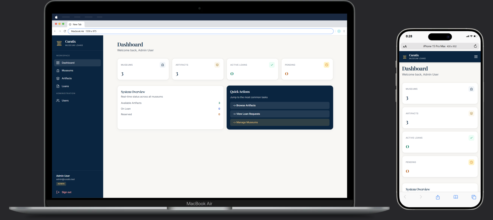
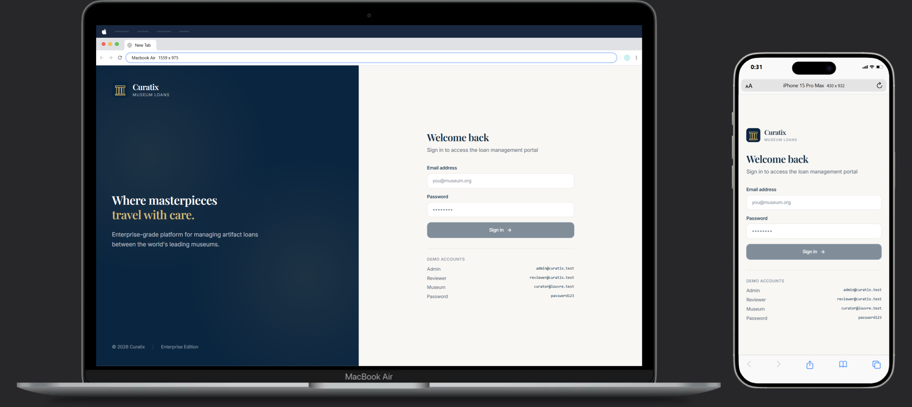
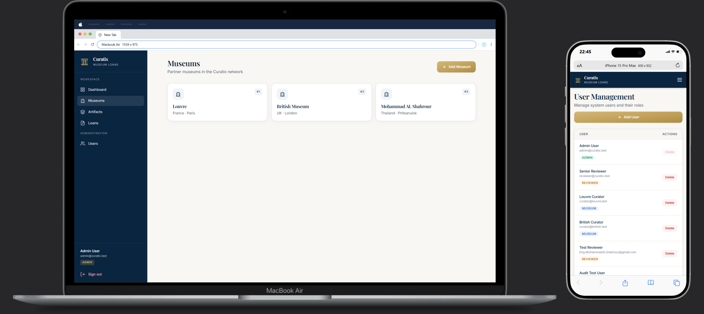
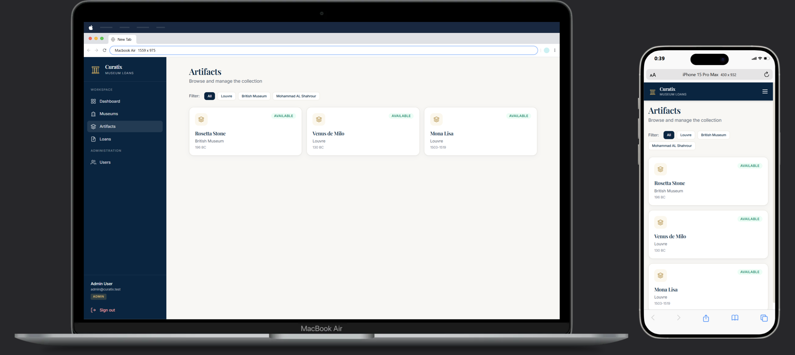
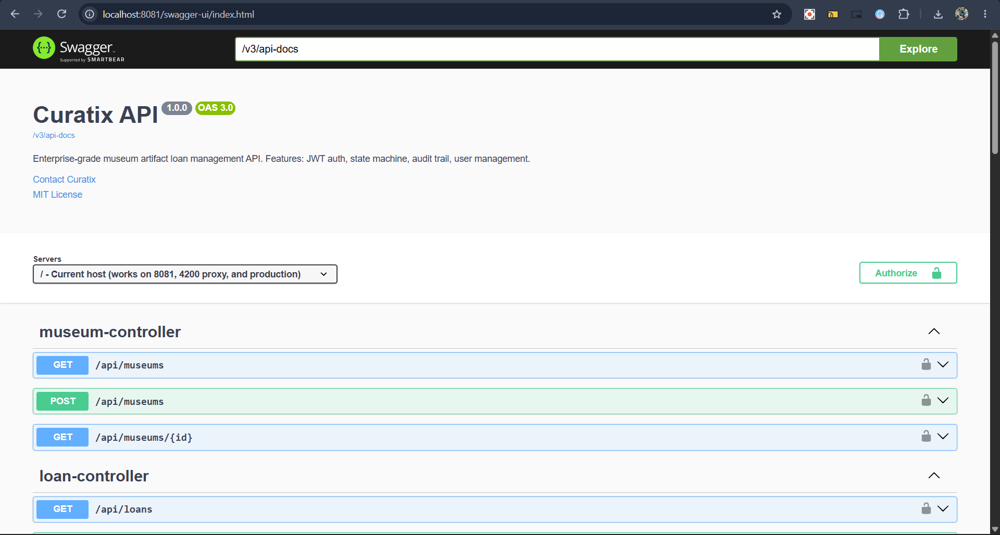
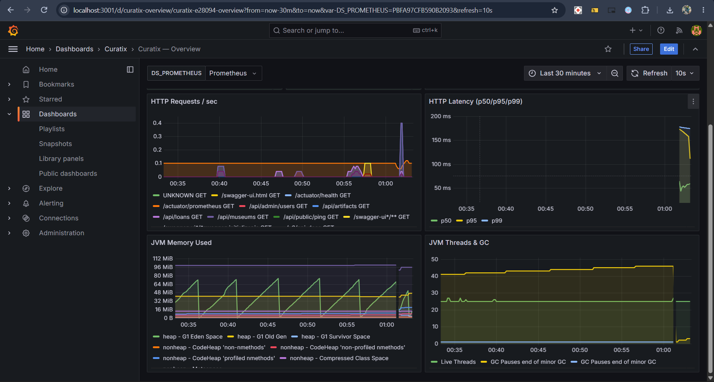

<div align="center">

# Curatix

**Enterprise Museum Loan Management System**

*Where masterpieces travel with care.*

[](https://spring.io/projects/spring-boot)
[](https://openjdk.org/projects/jdk/21/)
[](https://angular.dev)
[](https://www.postgresql.org)
[](https://docs.docker.com/compose/)
[](backend/src/test)
[](LICENSE)

[Features](#-features) · [Architecture](#-architecture) · [Quick Start](#-quick-start) · [API](#-api-reference) · [Design Decisions](#-design-decisions)

</div>

<p align="center"></p>

---

## 📖 What is Curatix?

**Curatix** is a full-stack, production-grade platform for managing **artifact loans between museums** — the process by which one museum borrows a piece from another for a temporary exhibition.

The workflow is governed by a strict **state machine** with three roles, full **audit trail**, **event-driven notifications**, **HMAC-signed webhooks**, and **Prometheus/Grafana observability** — all containerized in a 5-service Docker Compose stack.

> **Business domain**: The Louvre wants to borrow a Vermeer from the Rijksmuseum for a 3-month exhibition. Curatix handles the request, approval, shipment, and return — with every step authenticated, authorized, and audited.

---


---

## 📸 Screenshots

<table>
  <tr>
    <td width="50%"><br/><sub><b>Login</b></sub></td>
    <td width="50%"><br/><sub><b>Dashboard</b></sub></td>
  </tr>
  <tr>
    <td width="50%"><br/><sub><b>Museums</b></sub></td>
    <td width="50%"><br/><sub><b>Artifacts</b></sub></td>
  </tr>
  <tr>
    <td width="50%"><br/><sub><b>Loans — State Machine</b></sub></td>
    <td width="50%"><br/><sub><b>Admin — Users</b></sub></td>
  </tr>
  <tr>
    <td width="50%"><br/><sub><b>Swagger API</b></sub></td>
    <td width="50%"><br/><sub><b>Grafana Dashboard</b></sub></td>
  </tr>
</table>

## ✨ Features

### 🔐 Authentication & Authorization
- **JWT-based stateless auth** (HMAC-SHA256, `jjwt 0.12.6`)
- **BCrypt password hashing** (strength 10)
- **URL-based + method-level RBAC** with 3 roles: `ADMIN`, `MUSEUM`, `REVIEWER`
- **Admin-only endpoints** enforced via class-level `@PreAuthorize`

### 🎯 Loan State Machine

```
PENDING ─┬─► APPROVED ──► SHIPPED ──► RETURNED
         └─► REJECTED
```

- **12 business rules enforced** in `LoanService` (own-museum check, artifact availability, role scoping per transition)
- **Artifact status transitions**: `AVAILABLE` ↔ `RESERVED` ↔ `ON_LOAN`
- **31 JUnit tests** covering every transition, every guard, every edge case

### 📜 Audit Trail
- **Automatic** via JPA `@EntityListeners` — no manual `audit.log()` calls
- Records `actor_email`, `actor_role`, `ip_address`, `action`, `entity_type`, `entity_id`
- **`REQUIRES_NEW` transaction** — audit failure never breaks business tx
- Paginated admin endpoint with filters

### 📧 Event-Driven Notifications
- **Spring `ApplicationEventPublisher`** → `@EventListener @Async` → `EmailService`
- **HTML email templates** with Curatix brand (navy + gold)
- **`notification_logs` table** records every send: `SENT` / `FAILED` / `SKIPPED`
- **Safe dev mode**: emails disabled via `curatix.email.enabled=false`

### 🪝 HMAC-Signed Webhooks
- **`WebhookDispatcher`** subscribes to all `LoanEvent`s
- **HMAC-SHA256 signature** in `X-Curatix-Signature: sha256=<hex>`
- **Delivery log** in `webhook_deliveries` (status, response, error)
- Admin endpoints: list / create / delete / view deliveries

### 📊 Observability (Prometheus + Grafana)
- **7 custom Prometheus metrics**:
  - `curatix_loans_created_total`
  - `curatix_loans_rejected_total`
  - `curatix_loan_transitions_total{status}`
  - `curatix_loans_active` / `_pending` / `_shipped`
  - `curatix_loan_approval_duration_seconds` (histogram)
- **Grafana dashboard** with 7 panels (transitions/sec, HTTP latency p50/p95/p99, JVM memory, GC)
- **Prometheus scrapes** `/actuator/prometheus` every 10s

### 🎨 Modern Frontend
- **Angular 19** with **Standalone Components** and **Signals**
- **Functional guards/interceptors** (no deprecated class-based)
- **Tailwind CSS** with custom navy/gold/cream design system
- **Mobile-responsive** sidebar + modal dialogs
- **Lazy-loaded routes** (initial bundle ~120KB gzipped)

---

## 🏗 Architecture

```
┌─────────────────────────────────────────────────────────────────────────┐
│                          CURATIX ARCHITECTURE                            │
└─────────────────────────────────────────────────────────────────────────┘

  👤 Browser                                                              
     │ Angular 19 SPA                                                      
     │ HTTP :4200                                                          
     ▼                                                                     
  ┌──────────────┐                                                         
  │    nginx     │  SPA + Reverse Proxy                                     
  │   :4200      │                                                          
  └──────┬───────┘                                                          
         │ /api/*                                                           
         ▼                                                                  
  ┌────────────────────────┐                                                
  │   Spring Boot 3.3.5    │  REST API                                     
  │   Java 21              │  JWT Auth + RBAC                              
  │   :8080                │  State Machine + Audit + Events               
  └───┬────────────────┬───┘                                                
      │                │                                                    
      │ JDBC           │ /actuator/prometheus                               
      ▼                ▼                                                    
  ┌─────────────┐   ┌──────────────┐                                        
  │ PostgreSQL  │   │  Prometheus  │   scrape every 10s                     
  │ 16 :5432    │   │    :9090     │                                        
  │ 5 Flyway    │   └──────┬───────┘                                        
  │ migrations  │          │ datasource                                      
  └─────────────┘          ▼                                                
                     ┌──────────────┐                                       
                     │   Grafana    │   7-panel dashboard                    
                     │   :3001      │                                        
                     └──────────────┘                                       

  ════════════════════════════════════════════════════════════════════     
                                                                             
  EVENT FLOW (async, @EventListener)                                        
  ─────────────────────────────────                                        
  LoanService.publish(LoanEvent)                                            
        │                                                                    
        ├──► EmailService (HTML templates, dev-disabled)                    
        └──► WebhookService (HMAC-SHA256 signed POST)                       
                                                                             
```

### Layered Backend

```
com.curatix.museumloan
├── auth/          JWT login/register + DTOs
├── security/      JwtAuthFilter · JwtService · CustomUserDetailsService
├── user/          User entity + CRUD (ADMIN)
├── museum/        Museum entity + CRUD
├── artifact/      Artifact entity + catalog
├── loan/          LoanRequest + state machine + 12 rules
├── audit/         @EntityListeners + AuditService + AuditController
├── notification/  LoanEvent · EmailService · templates
├── webhook/       HMAC dispatcher · delivery log
├── metrics/       LoanMetrics (Micrometer)
└── config/        SecurityConfig · OpenApiConfig · SpringContext
```

### Database Schema (Flyway)

| Version | Table | Purpose |
|---------|-------|---------|
| V1 | `users`, `museums`, `artifacts`, `loan_requests` | Core domain |
| V2 | `users.museum_id` | MUSEUM role → museum FK |
| V3 | `audit_logs` | Immutable audit trail |
| V4 | `notification_logs` | Email send log |
| V5 | `webhooks`, `webhook_deliveries` | HMAC delivery log |

---

## 🚀 Quick Start

### Prerequisites
- Docker Desktop 4.x+ (with Compose V2)
- Ports 4200, 8081, 5433, 9090, 3001 free

### Run

```bash
git clone https://github.com/Eng-MohammadAlShahrour/Curatix-FullStack-SpringBoot-Angular-PostgreSQL-Docker.git
cd Curatix-FullStack-SpringBoot-Angular-PostgreSQL-Docker

docker compose up -d
```

Wait ~60s for Flyway migrations + JPA validation. Then:

| Service | URL | Credentials |
|---------|-----|-------------|
| **Frontend** | http://localhost:4200 | `admin@curatix.test` / `password123` |
| **API** | http://localhost:8081 | — |
| **Swagger UI** | http://localhost:8081/swagger-ui.html | Bearer JWT |
| **Prometheus** | http://localhost:9090 | — |
| **Grafana** | http://localhost:3001 | `admin` / `curatix_grafana_2026` |

### Demo Accounts

| Role | Email | Password | Museum |
|------|-------|----------|--------|
| ADMIN | `admin@curatix.test` | `password123` | — |
| REVIEWER | `reviewer@curatix.test` | `password123` | — |
| MUSEUM | `curator@louvre.test` | `password123` | Louvre |
| MUSEUM | `curator@british.test` | `password123` | British Museum |

---

## 📡 API Reference

**24 endpoints** documented in Swagger UI. Quick overview:

### Auth (`/api/auth`)
| Method | Path | Auth |
|--------|------|------|
| POST | `/register` | Public |
| POST | `/login` | Public |
| GET | `/me` | Bearer |

### Museums (`/api/museums`)
| Method | Path | Auth |
|--------|------|------|
| GET | `/` | Bearer |
| GET | `/{id}` | Bearer |
| POST | `/` | `ROLE_ADMIN` |

### Artifacts (`/api/artifacts`)
| Method | Path | Auth |
|--------|------|------|
| GET | `/` (opt. `?museumId=`) | Bearer |
| GET | `/{id}` | Bearer |
| POST | `/` | `ROLE_MUSEUM` |

### Loans (`/api/loans`)
| Method | Path | Auth |
|--------|------|------|
| GET | `/` (opt. `?status=`) | Bearer |
| GET | `/{id}` | Bearer |
| POST | `/` | `ROLE_MUSEUM` |
| PATCH | `/{id}/approve` | `ROLE_REVIEWER` |
| PATCH | `/{id}/reject` | `ROLE_REVIEWER` |
| PATCH | `/{id}/ship` | `ROLE_MUSEUM` (lender) |
| PATCH | `/{id}/return` | `ROLE_MUSEUM` (borrower) |

### Admin (`/api/admin/**`)
Users, Audit, Notifications, Webhooks — all `ROLE_ADMIN`, all paginated.

---

## 🧠 Design Decisions

### Why URL-based auth + method-level `@PreAuthorize` (hybrid)?
- **Coarse rules** (admin-only namespaces) in `SecurityConfig` — central, easy to audit
- **Fine rules** (transition actors) as URL patterns per transition — express the state machine in security
- **Zero `@PreAuthorize` on read endpoints** — they're authenticated by default, no role restriction

### Why `@Transactional(readOnly = true)` on read methods?
With `spring.jpa.open-in-view=false`, Hibernate's `Session` closes immediately after the repository call. Any subsequent lazy load (e.g. `artifact.getMuseum().getName()` in `ArtifactDto.from`) throws `LazyInitializationException`, which Spring dispatches to `/error` — and if `/error` isn't `permitAll`, the client sees a **misleading 403** instead of a 500.

**Fix**: wrap DTO construction in the same transaction that loads the entity. `readOnly=true` tells Hibernate to skip dirty-checking (minor perf win, no behavior change).

### Why `ApplicationEvent` (not a message broker)?
- Zero operational overhead for a portfolio project
- **`@Async`** isolates failure (email/webhook can't roll back a loan)
- **`@EventListener`** gives compile-time type safety
- **Trade-off**: no cross-instance delivery. Production would use Kafka/RabbitMQ.

### Why HMAC-SHA256 for webhooks?
- **`X-Curatix-Signature: sha256=<hex>`** — receiver can verify authenticity with shared secret
- **Prevents replay + tampering**: signature covers the full JSON payload
- **Industry standard** (Stripe, GitHub, Slack all do this)

### Why HMAC for JWT and HMAC for webhooks are separate secrets?
- **JWT secret** signs user tokens — leakage = auth bypass
- **Webhook secret** is per-endpoint — leakage = one integration compromised, not the system

---

## 🧪 Testing

**31 JUnit 5 tests** across 5 suites, all `@SpringBootTest` + H2 in-memory DB:

```bash
docker compose run --rm backend mvn test
```

| Suite | Tests | Coverage |
|-------|-------|----------|
| `AuthServiceTest` | 6 | Register, bcrypt, duplicate email, login, wrong password, unknown user |
| `LoanServiceTest` | 12 | All 4 transitions + 8 guard conditions |
| `MuseumServiceTest` | 4 | Create, list, get, 404 |
| `UserServiceTest` | 7 | CRUD + MUSEUM museumId validation |
| `MuseumLoanApplicationTests` | 1 | Context loads |

---

## 📊 Observability

### Grafana Dashboard (7 panels)
1. **Active Loans** (stat) — `curatix_loans_active`
2. **Pending Loans** (stat) — `curatix_loans_pending`
3. **Transitions/sec** — `rate(curatix_loan_transitions_total[5m])`
4. **HTTP Requests/sec** — per URI + method
5. **HTTP Latency p50/p95/p99** — histogram quantiles
6. **JVM Memory Used** — heap / non-heap
7. **JVM Threads & GC** — live threads + GC pause count

Dashboard JSON is **provisioned automatically** from `monitoring/grafana/dashboards/`.

---

## 🔐 Security Notes

| Concern | Mitigation |
|---------|------------|
| Password storage | BCrypt (strength 10) |
| Token forgery | HMAC-SHA256, 32+ byte secret |
| Token replay | 24h expiry, stateless, no refresh (MVP) |
| CSRF | Disabled (stateless API, JWT in header) |
| SQL injection | JPA repositories (parameterized) |
| Mass assignment | DTOs per request (records) |
| Audit integrity | `REQUIRES_NEW` tx, append-only table |
| Webhook spoofing | HMAC-SHA256 signature |
| Secrets in env | Dev defaults only; `.env` for prod |

**Production TODOs**: rotate JWT secret, enable HTTPS (Let's Encrypt), add rate limiting (Bucket4j), switch email to SES, add refresh tokens.

---

## 🗺 Roadmap

- [ ] Refresh tokens + Redis blacklist
- [ ] Kafka for webhook delivery (replace in-process `@Async`)
- [ ] Multi-tenancy (museum-scoped read filtering)
- [ ] Contract tests (Pact) for webhook consumers
- [ ] Terraform module for AWS ECS deployment
- [ ] Playwright E2E test suite

---

## 📄 License

MIT © 2026 [Mohammad Al-Shahrour](https://github.com/Eng-MohammadAlShahrour)

---

<div align="center">

*Built with ☕ and a lot of patience.*

</div>